# SAM Campus Slot — Project Report Screenshots & Architecture Gallery

This document compiles the complete set of **15 high-resolution (Retina 2x DPI)** system screenshots captured from the running **SAM Campus Slot** full-stack application. All images are stored in high fidelity in the `screenshots/` directory.

---

## 1. Authentication & Institutional Access

### `02_login_page.png` — Unified Single Login Page
- **Location**: `http://localhost:5173/login`
- **Description**: Unified Single Login portal that automatically identifies user role (Student, Faculty, or Administrator) directly from their institutional email (`regno@nec.edu.in` or `name-dept@nec.edu.in`), staff ID, or register number and routes them to their respective dashboard, featuring password visibility toggle and Google SSO.
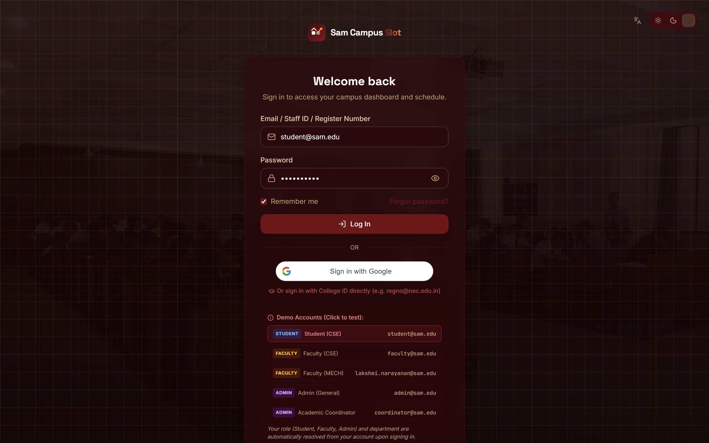

### `03_login_password_unmasked.png` — Password Visibility Toggle
- **Location**: `http://localhost:5173/login`
- **Description**: Interactive password visibility toggle unmasking credentials for user verification.
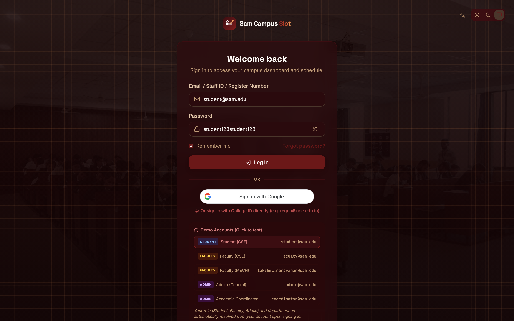

### `01_landing_page.png` — Cover Portal & Hero
- **Location**: `http://localhost:5173/`
- **Description**: The public cover portal presenting the hero section, smart room allocation features, and navigation CTA buttons.
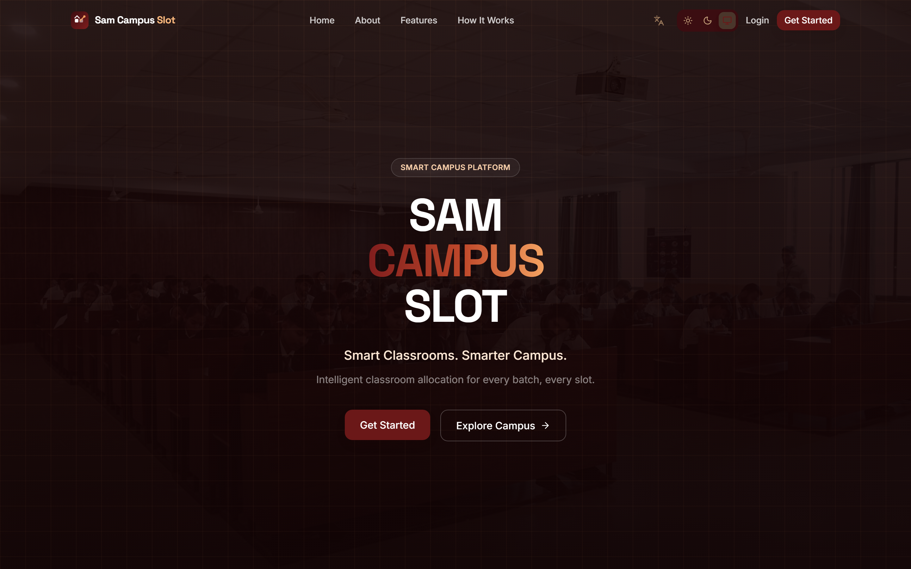

---

## 2. Departmental Second-Year Timetables (UG II Year / III Semester)

### `04_student_timetable_ece_ii_year.png` — ECE II Year
- **Department**: Electronics & Communication Engineering (ECE)
- **Batches**: B1, B2, B3
- **Subjects**: Signals & Systems (`23EC33C`), Electron Devices (`23EC31C`), Digital Electronics (`23EC32C`), Circuit Networks (`23EC34C`), Probability & Random Processes (`23MA31C`), IPR Study, GATE Training, and 3-way rotating labs across IC Lab and DSP Lab.
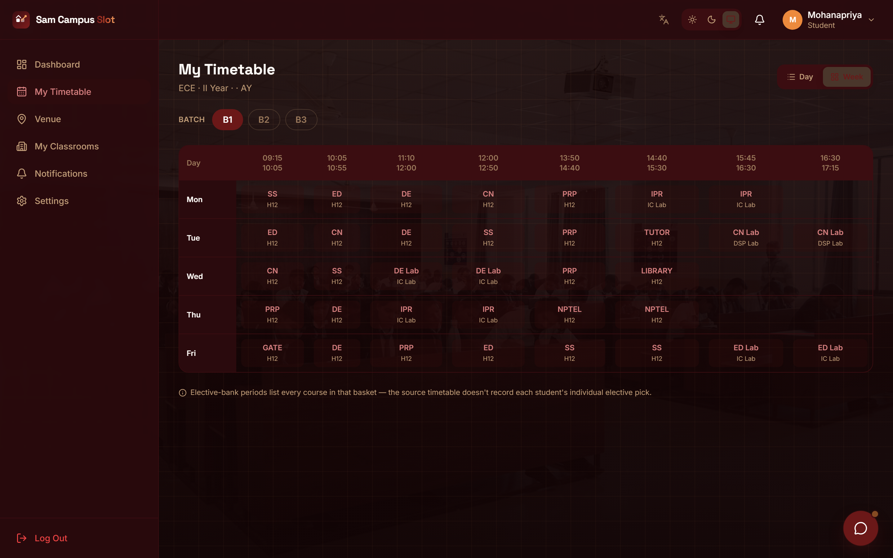

### `05_student_timetable_cse_ii_year.png` — CSE II Year
- **Department**: Computer Science & Engineering (CSE)
- **Batches**: B1, B2, B3
- **Subjects**: Data Structures (`23CS31C` in Halls F7/F8/F9), Computer Networks (`23CS32C`), Computer Organization & Architecture (`23CS33C`), Discrete Mathematics (`23MA31C`), Linux System Admin Lab, Cisco Lab, and Saturday Industrial Visit (GIV).
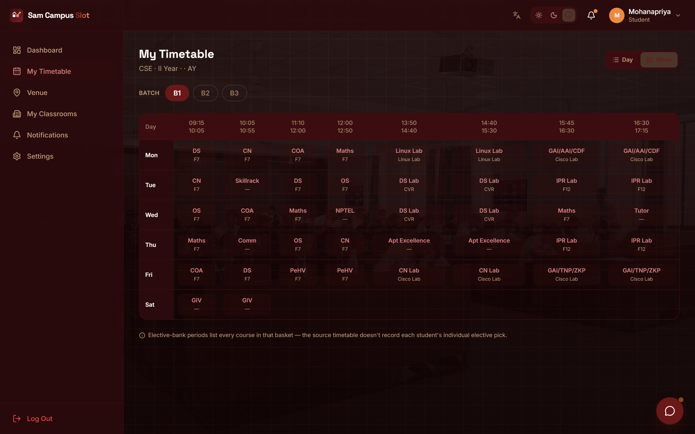

### `06_student_timetable_mech_ii_year.png` — MECH II Year
- **Department**: Mechanical Engineering (MECH)
- **Batches**: B1, B2
- **Subjects**: Engineering Thermodynamics (`23ME32C`), Fluid Mechanics & Machinery (`23ME33C` in Halls 4 & 5), Transforms & Numerical Methods (`23ME31C`), Basic Manufacturing Processes, BMP Workshop, and Fluid Mechanics Lab.
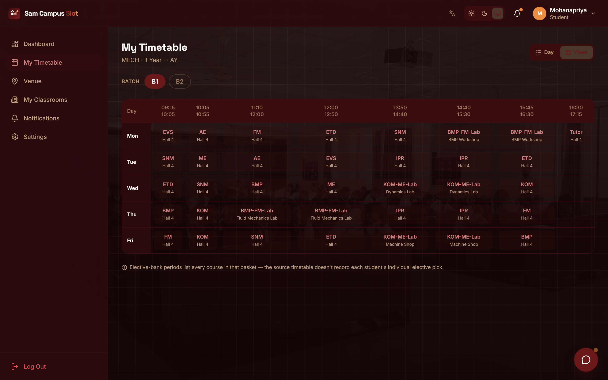

### `07_student_timetable_it_ii_year.png` — IT II Year
- **Department**: Information Technology (IT)
- **Batches**: B1, B2
- **Subjects**: Software Engineering (`23IT31C`), Data Structures (`23IT32C`), Computer Networks (`23IT38C`), Parallel lab split between Linux Lab (UG LAB III) and CN Lab (UG LAB II).
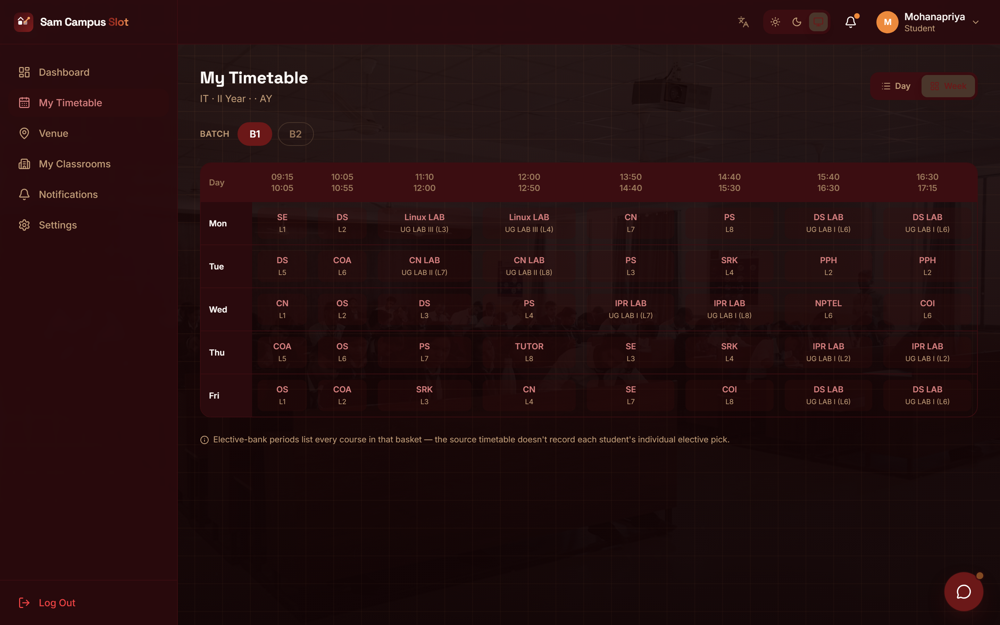

### `08_student_timetable_aids_ii_year.png` — AI&DS II Year
- **Department**: Artificial Intelligence & Data Science (AI&DS)
- **Batches**: B1, B2
- **Subjects**: Object Oriented Programming with Java (`23AD34C`), Data Structures (`23AD35C`), Artificial Intelligence (`23AD36C`), Linux System Admin, DA Lab, DL Lab, and AI Lab.
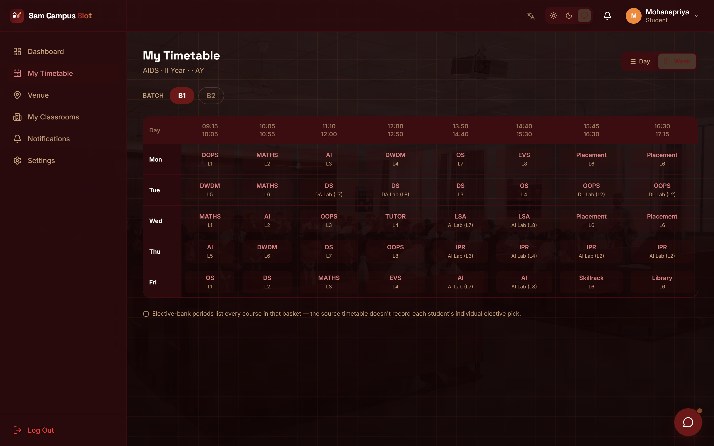

---

## 3. Student Venues & Classrooms

### `09_student_venue_page.png` — Student Venue Resolver
- **Location**: `http://localhost:5173/student/venue`
- **Description**: Real-time classroom venue resolver displaying scheduled room (ICL), course code, faculty in charge, room capacity (60 seats), Wi-Fi/Projector equipment status, and daily period sequence.
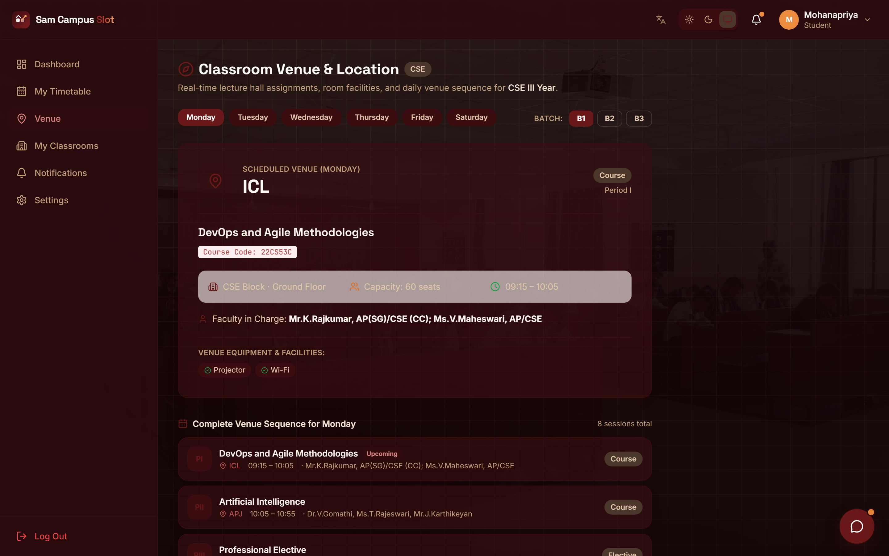

---

## 4. Faculty Teaching & Smart Allocation

### `10_faculty_teaching_schedule.png` — Faculty Teaching Schedule
- **Location**: `http://localhost:5173/faculty/timetable`
- **Description**: Dedicated faculty workload monitor showing teaching sessions (43 weekly hours, 7 classes today, 9 assigned rooms, 14 subjects) and confirmed daily time slots.
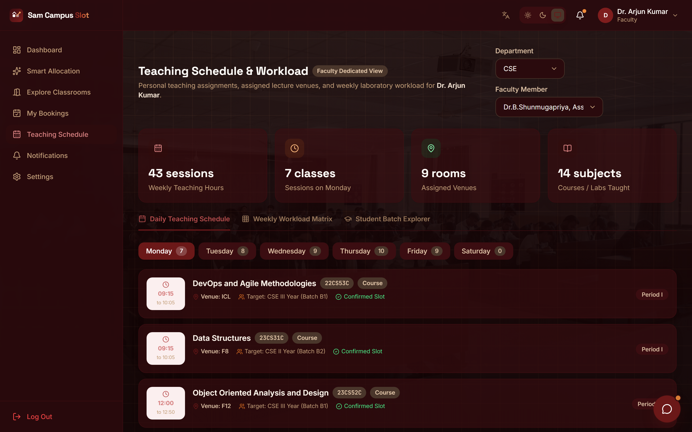

### `11_faculty_smart_allocation.png` — Smart Allocation Engine
- **Location**: `http://localhost:5173/faculty/allocation`
- **Description**: AI-driven multi-factor classroom allocation engine optimizing for student capacity (58 seats), interactive smart boards, AC, Wi-Fi, and real-time conflict avoidance.
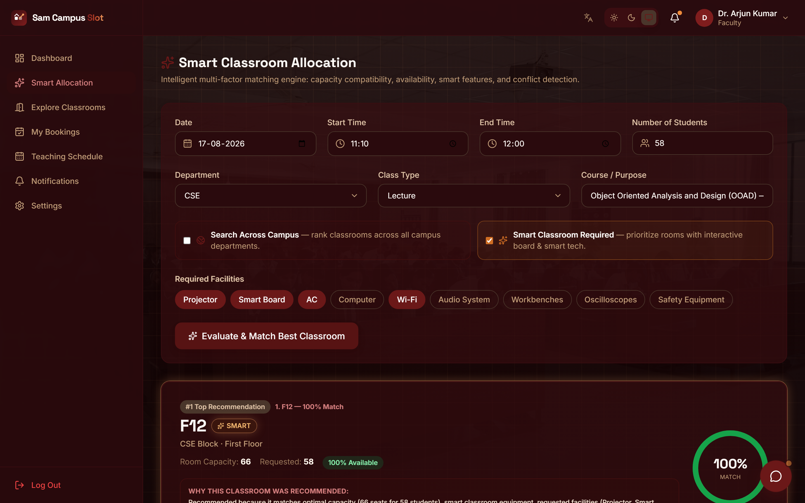

---

## 5. Administrative Oversight & User Management

### `12_admin_analytics_dashboard.png` — Admin Analytics Dashboard
- **Location**: `http://localhost:5173/admin/dashboard`
- **Description**: Operational dashboard displaying MongoDB live metrics: 5 registered users, 61 classrooms, active bookings, maintenance blocks, smart room counts, and weekly utilization graphs.
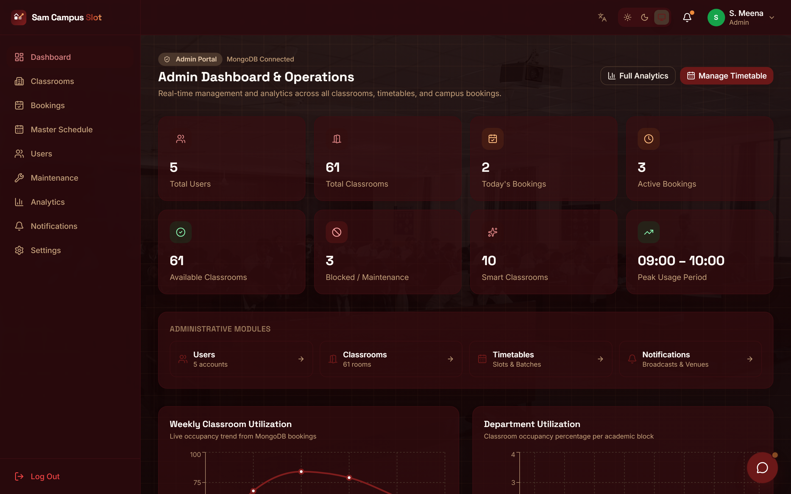

### `13_admin_master_venue_matrix.png` — Master Room Occupancy Matrix
- **Location**: `http://localhost:5173/admin/timetable`
- **Description**: Master Room Occupancy Matrix monitoring 22 venues across 7 academic periods with instant occupied/available status indicators.
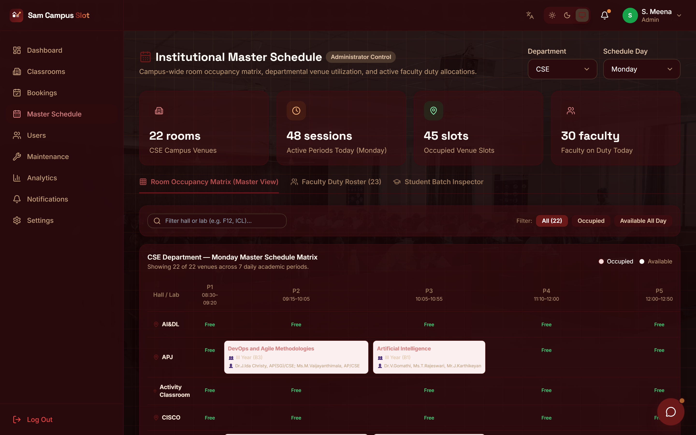

### `14_admin_users_filtered.png` — Admin User Directory & Filters
- **Location**: `http://localhost:5173/admin/users`
- **Description**: User Management directory equipped with dedicated role filter badges (Student, Faculty, Admin), search bar, and department/year breakdown.
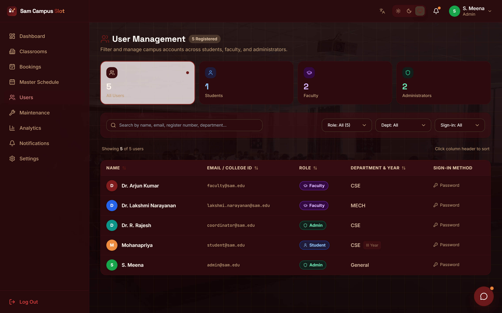

---

## 6. Campus Assistant Chatbot

### `15_campus_assistant_chatbot.png` — Campus Assistant Chat Widget
- **Component**: Floating Campus Assistant ChatWidget
- **Description**: Real-time AI Assistant answering database-grounded queries for students and faculty regarding upcoming lectures, room availability, smart classrooms, and venue changes.
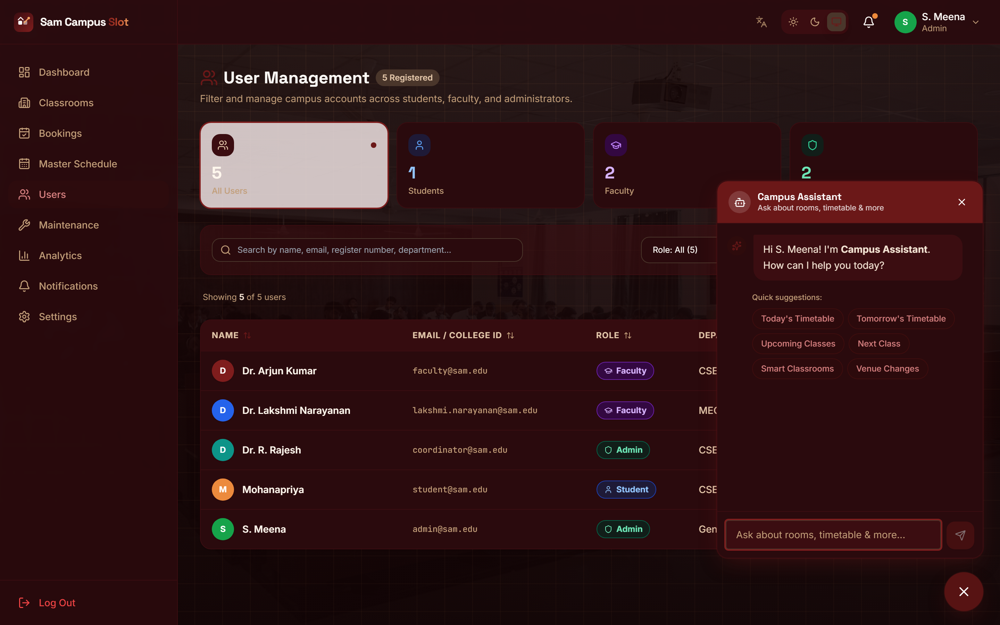

---

## Quick Reference Table for Report Writing

| # | Filename | Module | Key Features Shown |
|---|---|---|---|
| 01 | `01_landing_page.png` | Public | Hero banner, features overview, portal access |
| 02 | `02_login_page.png` | Auth | Unified Single Login, auto role identification, Google SSO |
| 03 | `03_login_password_unmasked.png` | Auth | Eye icon password toggle, validation feedback |
| 04 | `04_student_timetable_ece_ii_year.png` | Timetable | ECE II Year, 3 Batches (B1/B2/B3), rotating lab slots |
| 05 | `05_student_timetable_cse_ii_year.png` | Timetable | CSE II Year, 3 Batches, core theory & coding labs |
| 06 | `06_student_timetable_mech_ii_year.png` | Timetable | MECH II Year, Batches B1/B2, workshop & fluid labs |
| 07 | `07_student_timetable_it_ii_year.png` | Timetable | IT II Year, parallel lab allocations |
| 08 | `08_student_timetable_aids_ii_year.png` | Timetable | AI&DS II Year, data analytics & AI labs |
| 09 | `09_student_venue_page.png` | Venues | Real-time classroom details, amenities, daily sequence |
| 10 | `10_faculty_teaching_schedule.png` | Faculty | Teaching workload stats, daily & weekly periods |
| 11 | `11_faculty_smart_allocation.png` | Allocation | Multi-factor room recommendation engine |
| 12 | `12_admin_analytics_dashboard.png` | Analytics | MongoDB live counters, utilization analytics charts |
| 13 | `13_admin_master_venue_matrix.png` | Admin | 22 venues × 7 academic periods occupancy matrix |
| 14 | `14_admin_users_filtered.png` | Admin | Filter buttons for Student, Faculty, Admin |
| 15 | `15_campus_assistant_chatbot.png` | AI Chatbot | Natural language queries for rooms, schedule & timings |
